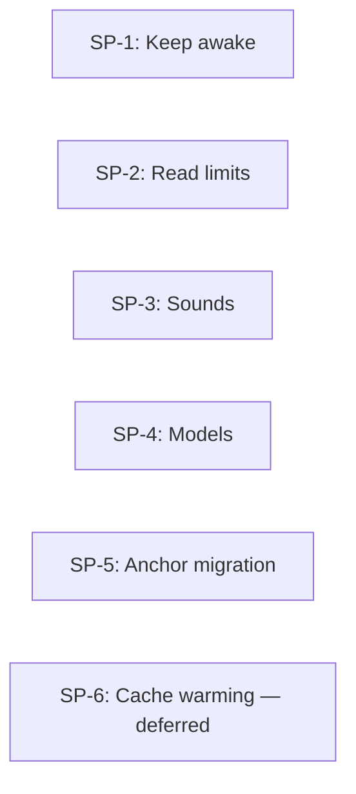

# Council of Wizards Plan

## **FEATURE INFO**
- **Project**: Joro — agent-memory-environment
- **Date**: 2026-11-11
- **Agent**: software-architect
- **Feature**: Host setup for agent activity: prevent automatic sleep, configure read/output limits, notify on completion, expose requested OpenCode models, relocate anchor-memory installation responsibility, and — deferred — keep a chosen conversation's prompt cache warm.
- **Source Protocol**: `/council-of-wizards` — /council-of-wizards

*CRITICAL INSTRUCTION: To continue this plan: load the source protocol above, then inspect which sections below are filled vs unfilled to infer your current step.*

---

## **INHERITED CONTEXT**
*Filled at investigation step 0 with whatever was settled before this plan existed. The two sources are recorded separately and never merged — write "None" under a part that does not apply.*
*These decisions are **not yours to reopen**. If one looks wrong, STOP and surface it to [USER-NAME] — do not silently re-decide it here or in Confirmed Decisions below.*

### From the Parent Plan
None — not a sub-plan.

### From Pre-Planning Discussion
- **Discussion**: Pre-planning discussion with Alvi, 2026-11-11.
- **Agreed scope**, verbatim from Alvi:
  - "create a small watcher, that if, a claude or opencode agent is running (maybe also einherjar), then this watcher do something so the pc won't sleep / hibernate"
  - "setup read max tools on file and mcp for claude and opencode"
  - "setup sound notification after an agent has finished a task"
  - "setup showing models for opencode (the openrouter relace/fp4 for deepseek is the important one for me)"
  - "move anchor memory to here"
  - "the order is already based on priority (the watcher is high prio)"

| # | Settled decision | Chosen | His reason / discussion record | Status |
|---|------------------|--------|-------------------------------|--------|
| 1 | Repository | Public alvseek/agent-memory-environment; layer name Joro. | Explicit naming and visibility choices in conversation. | Settled |
| 2 | Structure and delivery direction | Procedure content plus local host scripts; local skills first; no MCP server now. | "ok we'll go with that" after the proposed structure and delivery recommendation. | Settled |
| 3 | Power-timeout procedures | Do not add override-power-settings or its dependent reset procedure. | "don't add the override-power-settings yet, since we may not needed that" | Settled |
| 4 | Planning and order | Council planning for all five; investigate, build, and verify the watcher first. | "go" after the Council recommendation and priority-first execution proposal. | Settled |

- **Considered and rejected**: Rite of Creation as the outer workflow — the work is multiple deliverables rather than successive kinds of work gating one deliverable. Permanently rewriting power timeouts is not the proposed watcher approach.
- **Proposed constraints accepted with the planning go-ahead**: distinguish active work from an open process; investigate existing tools and hooks before building; use temporary sleep prevention and release it when work stops; Munnin continues to own and supply memory content while Joro owns host installation. Exact behavior remains subject to requirements clarification.
- **Left open at entry**: Supported operating systems and Claude clients; what counts as activity or task completion; Einherjar coverage; unattended installation scope; actual supported read/output limits and desired values; exact OpenRouter model/provider/precision spelling; migration compatibility for anchor-memory. Do not interpret "relace/fp4" as an approved correction to a vendor or model identifier.

### Investigation record — 2026-11-11

- Local version commands returned OpenCode v2.0.24 and Claude Code 2.1.278; an Einherjar executable is present. Version detection does not prove any hook or keep-awake integration works.
- Claude Code's [hooks reference](https://code.claude.com/docs/en/hooks) documents prompt, tool, permission, stop, error, and session events. Its current documentation includes features newer than the installed version; verify required events on the installed client in the watcher sub-plan.
- OpenCode's [plugin overview](https://opencode.ai/docs/build/plugins) and [server plugin reference](https://opencode.ai/docs/build/plugins/server) expose session hooks and an event stream. An open server process is not proof that a session is doing work. Watcher and notification work may consume the same activity information; whether to share it is a decomposition decision, not settled yet.
- Prior art: [Insomnia](https://github.com/stanley-projects/Insomnia) advertises Windows sleep prevention with Claude Code integration; its website does not list an OpenCode smart integration. It is a candidate, not an adoption decision: source-level fit, licensing, lifecycle behavior, and installed-version compatibility still need checking. [cc-caffeine](https://github.com/samber/cc-caffeine) is explicitly deprecated and unmaintained; do not treat it as a maintained solution.
- Loaded knowledge record `23527779cf1e4077a8eab6389b6b89ae` in full. It records independent OpenCode output-byte, output-line, and file-reader per-line limits. These are dated observations, not authority for this build. Read-limit sub-plan must measure the current clients before choosing supported settings.
- Loaded Munnin's served `anchor-memory` procedure in full. It fetches tenant-owned content, writes a stamped permanent-layer file, and adds a harness-specific pointer. Migration must preserve bytes and existing instruction entries; do not copy tenant memory into this public repository. No host configuration or power settings have been changed by this planning session.
- Requirements round accepted by Alvi: "OQ1: Claude code only. proceed". This accepts the presented defaults: Windows first, allow normal sleep while waiting for input, and verify Einherjar-launched Claude/OpenCode runs through those clients. Ordinary Claude Desktop/browser chats are excluded.
- Decomposition confirmed by Alvi: "proceed". Council planning and self-review are complete; the next gate is final review before launching SP-1. No implementation or host installation has started.

---

## **REQUIREMENTS BREAKDOWN**
*Filled AFTER [USER-NAME] confirms the WAIT Options (Step 6). This table is the formal record of confirmed requirements that informs the scope gate and sub-plan decomposition.*

| # | Requirement | Description |
|---|-------------|-------------|
| R1 | Keep awake during agent work | Windows-first integration for Claude Code and OpenCode using temporary native requests while covered work remains. Later approved amendment: Claude permission waits retain protection; other wait semantics remain client-specific. Preserve power timeouts and explicit sleep/lid/critical-battery policy. Multiple-session safety and real client behavior require verification; battery/locked-screen protection remains unverified. Alvi subsequently cut the implementation back to the small helper/adapters with focused tests; see the current child plan rather than reviving the earlier larger architecture. |
| R2 | Configure read/output limits | Provide repeatable host setup for supported Claude Code and OpenCode file-read and MCP-output limits. Measure the installed clients, distinguish independent ceilings, preserve unrelated settings, verify effective changes, and report hard limits honestly rather than claiming they were raised. Exact values remain for the child plan. |
| R3 | Completion sounds | Provide configurable sound notification after a covered agent finishes a task. Define and verify completion separately from approval waits, failure, cancellation, and child/background activity; exact alert policy remains for the child plan. |
| R4 | OpenCode model availability | Make the requested OpenRouter DeepSeek model/provider/precision selection available in OpenCode, after verifying the exact identifier intended by "relace/fp4" and current route capabilities. Verify effective selection rather than only a picker label. Do not silently change the default model or purchase credit. |
| R5 | Anchor-memory installation ownership | Move the host installation workflow to Joro while Munnin retains ownership and supply of memory content. Preserve permanent-layer bytes and unrelated harness instructions, keep tenant content outside the public repository, and settle compatibility for existing callers before removing the old entry point. |
| R6 | Cache warming mechanism | Keep one chosen conversation's provider-side prompt cache warm, on a chosen platform, with a per-model lifetime taken from provider data and an on/off that a person or an agent can operate. **Deferred**: no code and no configuration change has been made, and the delivery shape is still an open decision. Constraints already established rather than assumed: a standalone script cannot refresh a session's prefix because only the harness holds the exact rendered tools-plus-history; Claude Code offers no unrecorded ping path, since `-p --resume` appends a real turn to that transcript; and warming a short non-renewing cache costs more than a single cold miss. |

**Accepted requirements-round defaults**: Windows first; Claude means Claude Code only, not ordinary Desktop/browser chats; waiting for human input does not itself keep the PC awake; Einherjar coverage is verified through its underlying Claude/OpenCode runs. Work remains ordered R1 through R5 by Alvi's priority. Installation and migration actions are not authorized merely by this requirements approval.

---

## **SCOPE GATE**
*Evaluate whether this feature truly needs multi-plan orchestration (council) or can be handled by a single `/high-wizard`.*

**Criteria** — council is needed when ANY of these are true:
- [x] The work holds **several deliverables, released together**, rather than one
- [ ] It requires **integration contracts** between parts (one plan produces what another consumes)
- [x] The scope is **too large for a single `/high-wizard`** to cover without losing detail

**Not needed when**: the work is one deliverable whose release finishes it (a single `/high-wizard`), or its parts must pass phases that gate each other (that is `/rite-of-creation`).

**Assessment**: Five distinct host capabilities need separate investigation and verification. They are not successive SDLC phases of one deliverable. A Council keeps their ownership, compatibility work, and delivery coordinated without delaying the high-priority watcher for unrelated model or memory work. Watcher and sound integrations may share activity signals; an integration contract is a candidate to investigate during decomposition, not yet a confirmed dependency. Verify the watcher first; batch any changes shipping together once rather than requiring one all-or-nothing release of all five.

**Decision**: [x] Proceed with Council | [ ] De-escalate to `/high-wizard`

Requirements and scope assessment confirmed by Alvi: "go". Decomposition subsequently confirmed: "proceed".

*If de-escalating: delete this file, launch `/high-wizard` with the requirements already gathered above.*

---

## **CONFIRMED DECISIONS**
*These decisions were collected during decomposition investigation and confirmed by [USER-NAME]. The reasons serve as the analysis record for why the feature was decomposed this way.*

| # | Decision | Chosen | Reason |
|---|----------|--------|--------|
| 1 | Coupling of watcher and notifications | Independent integrations; reuse native client features where they meet requirements. Alvi: "proceed A". | Avoid making sounds depend on a watcher service; OpenCode documents native completion sounds. Shared lifecycle concepts do not establish a need for a shared runtime. Each child must verify its own required client behavior. |
| 2 | Sub-plan ownership | Five capability-based sub-plans, one requirement each. | Each deliverable can be investigated and verified independently. Watcher internals and exact client configuration belong to the owning child, not this Council. |
| 3 | Execution strategy | Sequential, in Alvi's priority order, watcher first. No delegation planned. | "the order is already based on priority (the watcher is high prio)"; lower-priority work must not delay watcher verification. This is priority ordering, not a fabricated technical dependency. |
| 4 | Protocol assignment | High Wizard for watcher, read limits, and anchor migration; Quick Wizard initially for sounds and models. | Lifecycle safety, independent limits, and cross-repository migration need explicit investigation. Sound/model configuration is initially a smaller change; if investigation exposes a larger deliverable, surface that finding before expanding it. |

---

## **SUB-PLANS TABLE**
*Single canonical table — all other sections reference sub-plans by their ID. Do NOT duplicate this table elsewhere.*

| ID | Sub-Plan Name | Description | Requirements | Protocol | Plan File |
|----|--------------|-------------|--------------|----------|-----------|
| SP-1 | Agent keep-awake | Evaluate prior art, detect active sessions, temporarily prevent idle sleep, clean up reliably, install and verify on Windows. | R1 | HW | [SP-1-agent-keep-awake.md](SP-1-agent-keep-awake.md) |
| SP-2 | Read and output limits | Investigate independent client ceilings, configure supported values repeatably, and verify effective limits. | R2 | HW | [SP-2-read-output-limits.md](SP-2-read-output-limits.md) |
| SP-3 | Completion sounds | Evaluate native features, define completion alert behavior, and verify sound delivery. | R3 | QW initially | [SP-3-completion-sounds.md](SP-3-completion-sounds.md) |
| SP-4 | OpenCode model selection | Resolve the requested model/provider/precision, configure selectable entries, and verify routing. | R4 | QW initially | [SP-4-model-selection.md](SP-4-model-selection.md) |
| SP-5 | Anchor-memory migration | Transfer host installation responsibility to Joro with byte-preserving installation and a compatible transition from Munnin. | R5 | HW | [SP-5-anchor-memory-migration.md](SP-5-anchor-memory-migration.md) |
| SP-6 | KV cache warming | Keep one conversation's prompt cache warm on a chosen platform, with a per-model lifetime and a manual or agent-driven switch; delivery shape still open. Deferred. | R6 | HW | [SP-6-kv-cache-warming.md](SP-6-kv-cache-warming.md) |

These are reserved child-plan paths. Child files are created when the approved Council launches them; they do not exist yet.

**How to fill**: Each sub-plan groups related requirements into a coherent deliverable. Protocol column indicates `/high-wizard` (complex), `/pixel-wizard` (design-driven, with a visual reference to match), or `/quick-wizard` (simple). `Plan File` links to the sub-plan's file inside this folder once created. A `/quick-wizard` sub-plan keeps its plan in plan mode or in conversation rather than on disk, so its finished plan is written to that path once approved.

**Status lives in the Execution Log and nowhere else.** A status column here would be a second owner for one value, and it would go stale, because the procedure only ever advances a sub-plan in the log.

**Each sub-plan launch carries a handoff payload** — the decisions, contracts, and scope that bind it. See the Subplan Handoff component; a path alone is not a handoff.

---

## **INTEGRATION CONTRACTS**
*References to separate YAML contract files that define the interfaces between sub-plans. Use industry-standard formats (OpenAPI, AsyncAPI, JSON Schema).*

None — sub-plans have no integration dependencies. No shared activity service is required. Existing client configuration files are shared installation targets, not a new runtime contract: each installer must preserve unrelated entries, and sequential execution must verify that earlier installed behavior still works. Munnin's content-supply boundary and migration compatibility are owned by the anchor child.

**How to fill**: Identify what data/interfaces flow between sub-plans. Create a YAML contract file for each integration point using the appropriate industry standard. File paths are relative to this plan's folder. The "Verified" column is checked during Feature Completion when both sides of the contract are confirmed working.

*If no integration contracts are needed (sub-plans are independent), write "None — sub-plans have no integration dependencies" and remove the table.*

---

## **DEPENDENCY GRAPH**
*Mermaid diagram showing sub-plan relationships. Identifies what can run in parallel and what must be sequential.*

**Parallel opportunities**: No technical prerequisite edges are currently required between sub-plans, but parallel execution is not selected. Run SP-1 through SP-5 sequentially in priority order. Do not introduce runtime coupling solely to share lifecycle vocabulary.

**Critical path**: No multi-plan technical dependency chain has been established. The chosen execution sequence is SP-1, then SP-2, then SP-3, then SP-4, then SP-5, with SP-6 deferred outside that sequence until Alvi schedules it; no duration estimate is claimed. Watcher investigation, implementation and verification must finish before lower-priority execution begins.

**Review gate**: Decomposition confirmed by Alvi: "proceed". This document is ready for final Council review. After Alvi instructs execution to start, launch SP-1 through its assigned High Wizard protocol; that child owns its implementation decisions and approval gates. Do not interpret Council approval as permission to skip those gates.

**How to fill**: Draw dependencies based on which sub-plans produce outputs that others consume (linked to Integration Contracts). Sub-plans with no dependency between them can run in parallel — highlight these opportunities. The critical path is the longest chain of sequential dependencies.

---

## **EXECUTION LOG**
*Track progress of each sub-plan. This is the single source of truth for master-level progress **and for every sub-plan's status** — the Sub-Plans Table deliberately carries no status column. Each sub-plan's own plan file has its own detailed execution log.*

**Execution Protocol for AI**:
I have to use this document as my **ONLY** source of truth to track which sub-plans are done and which are next. For each sub-plan, I launch `/high-wizard`, `/pixel-wizard` or `/quick-wizard` as specified in the Sub-Plans Table, then update this log. Sub-plans can be executed in parallel if the dependency graph allows.

| Sub-Plan | Status | Started | Completed | Agent/Session | Notes |
|----------|--------|---------|-----------|---------------|-------|
| SP-1 | DONE | 2026-11-11 10:10 | 2026-11-12 | software-architect, 2026-11-12 session | Closed by Alvi's decision ("yes, mark it done") on the **minimal scope** he approved, not on the original R1 acceptance list. Shipped: helper, native power requests, Claude and OpenCode adapters, installer, agent procedure, focused tests, and the real client evidence recorded in the child plan. Accepted as **unverified and out of scope**: battery/locked-screen endurance, ordinary Claude terminal idle timing, full OpenCode wait/background/reload coverage, Einherjar-launched runs, registry startup round-trip, full uninstall. No GitHub release artifact; no orientation map. R1 is therefore closed as "minimal keep-awake delivered", not as "every original criterion proven". |
| SP-2 | NOT STARTED | — | — | — | — |
| SP-3 | NOT STARTED | — | — | — | — |
| SP-4 | NOT STARTED | — | — | — | — |
| SP-5 | NOT STARTED | — | — | — | — |
| SP-6 | NOT STARTED | — | — | — | **Deferred on 2026-11-12** — Alvi: "maybe add it as SP-6. we will try implement it when we have time. but for now we will defer." Not blocked, just not begun: no code, no config change. Settled before deferral: OpenCode ships warming but only at global, provider and model granularity, and it is off in this machine's config; Claude Code has TTL settings with no keepalive and a 1-hour ceiling; a standalone script cannot refresh a session's prefix. Open at launch: profile-based config (A) vs per-conversation controller (B) vs owning the loop (C), and whether Claude Code's `-p --resume` pings may leave turns in a transcript. It writes `opencode.jsonc` provider settings, the same file SP-4 does, so whichever runs second must preserve the other's entries. |

**Status values**: NOT STARTED → IN PROGRESS → DONE → BLOCKED (with reason in Notes)

---

## **QA HANDOFF**
*Filled at Step 18. This council is **not** runtime-verified — this section records the plan for that verification, which happens in a QA session with the stack up. Each sub-plan owns the checklist for its own change; this section owns the batch, which no sub-plan can see.*

- **Sub-plan checklists**: none exist. SP-1 closed on a deliberately narrowed scope without a `qa/` checklist; its evidence is inline in the child plan instead. Every later child must record its own checklist or a justified skip at completion.
- **Cross-plan integration**: NOT covered — nothing has been implemented. After each installation, verify that earlier Joro-managed client configuration and behavior remain intact; there is no shared runtime contract to exercise.
- **Runtime verification**: SP-1's native-request and real-client evidence is recorded in its child plan; that is component evidence, not a batch run. The batch remains **NOT runtime-verified**, and no SP-2 work has started. Record actual checklist paths and evidence here as later work lands.
- **Release**: Watcher-first delivery; do not hold it for lower-priority work. Release changes that ship together as one batch. Public commits must contain no tenant memory, credentials, machine baselines, or captured private hook payloads. Final feature completion requires all five children, even when the watcher has shipped earlier.

## **COUNCIL SELF-REVIEW**

- Requirements R1 through R5 are each assigned exactly once, to one independently verifiable capability.
- No child requires its own decomposition on the evidence currently available. Reassess openly if its investigation establishes otherwise; do not silently expand scope.
- Priority order is explicit and is not presented as a technical dependency graph. No delegation or parallel execution is planned.
- Existing-tool adoption versus custom watcher implementation, client event mappings, sound policy, concrete limits, model identity, and anchor compatibility remain owning-child decisions, not hidden assumptions in this Council.
- No host changes are required to approve this Council. Any installer must preserve unrelated settings; removing Munnin's existing anchor entry point requires a separate migration decision in its child.
- Consistency fixes at final review: replaced stale gate text, added the missing execution-log rows for SP-4 and SP-5, and replaced QA template slots with honest not-started status and the verification work still owed.

---

## **FEATURE COMPLETION CHECKLIST**
*Final verification before marking the feature complete.*

- [ ] All sub-plans have status DONE in Execution Log
- [ ] All integration contracts verified (Verified column checked)
- [ ] Cross-plan integration settled, and the `## QA HANDOFF` section filled: the sub-plan checklists listed, and the batch marked **not runtime-verified** with its next action
- [ ] No BLOCKED sub-plans remaining
- [ ] Documentation updated (if applicable)
- [ ] The sub-plans that shipped together are released **once** — batch them into a single deployment rather than deploying per sub-plan
- [ ] [USER-NAME] confirms feature is complete

---

## **POST-COMPLETION**
After feature is complete and checklist passes, move the entire council folder to `plans/completed/`:
`mkdir -p ./plans/completed && mv ./plans/[this-folder] ./plans/completed/[this-folder]`
