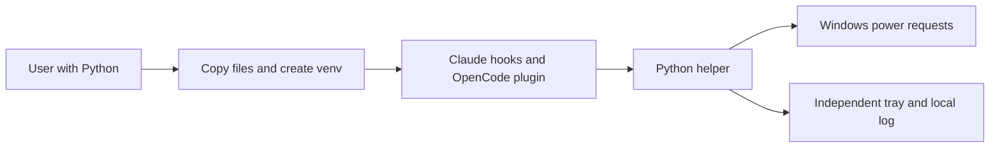

# High Wizard Plan

## **PROJECT INFO**
- **Project**: joro-awake (product) / agent-memory-environment (inclusion and distribution)
- **Date**: 2026-11-14
- **Agent**: software-architect
- **Theme**: No-Python Windows installer and trusted distribution, planning only
- **Status**: Expanded early review approved. Solution and implementation phases prepared for final review; implementation has not been authorized or started.
- **Source Protocol**: `/high-wizard` — /high-wizard

*CRITICAL INSTRUCTION: To continue this plan: load the source protocol above, then inspect which sections below are filled vs unfilled to infer your current step.*

---

## **INHERITED CONTEXT**
*Filled at investigation step 0 with whatever was settled before this plan existed. The two sources are recorded separately and never merged — write "None" under a part that does not apply.*
*These decisions are **not yours to reopen**. If one looks wrong, STOP and surface it to [USER-NAME] — do not silently re-decide it here or in Confirmed Decisions below.*

### From the Parent Plan
- **Parent plan**: None — independent follow-on plan, not a sub-plan.
- **Assigned scope**: None from a parent. The separate source-preview Quick Wizard has completed and its public download was independently verified; do not duplicate that task.

| # | Inherited decision | Chosen | Parent's reason | Status |
|---|--------------------|--------|-----------------|--------|
| — | None | — | — | — |

- **Integration contracts**: None from a parent plan. Source-preview QW subsequently completed: standalone product/submodule f3519d1a45029c01862dfdd69a84a93ffc55f418; public preview v0.1.0 independently verified. Parent distribution integration 8f9bae7, release evidence 5e6fb63.
- **Pushed-down open items**: None.

### From Pre-Planning Discussion
- **Discussion**: Pre-planning discussion with Alvi, 2026-11-14.
- **Agreed scope**: Create a High Wizard plan for the no-Python Windows package and trusted distribution; no implementation, purchase, identity submission, or Store submission is authorized by asking for this plan.

| # | Settled decision | Chosen | His reason | Status |
|---|------------------|--------|------------|--------|
| 1 | Purpose | Free product / marketing experiment | "not really getting any benefit, but just a form of testing if I can market a product" | Settled |
| 2 | Packaging sequence | Source/Python preview now; no-Python Windows package required before marketing | "A for now, but we should B before I can market it" | Settled |
| 3 | Trust goal and distribution | Microsoft Store-signed package first, not a direct-download signed MSI or a mere Store listing | "ok let's B, for marketing it should be really clear" after clarification that direct-download signed apps can still show the unrecognized-app warning | Settled; supersedes earlier MSI preference |
| 4 | Product inclusion | Standalone public joro-awake; agent-memory-environment includes it as submodule and prepares download package | "the original agent-memory-environment has to have the joro-awake, it will provide the python script to be downloaded like the einherjar wheel"; revised QW plan explicitly "approved" | Settled |
| 5 | Server scope | Package preparation now, actual serving endpoint deferred | User selected "A" for "Build the downloadable package now; prepare Joro to serve it later." | Settled |
| 6 | License | MIT for product source, dependency licenses retained | User said "proceed" to MIT | Settled |
| 7 | Planning ownership | Parent plans with Alvi; delegate only after implementation approval | "the quick wizard plan will be built by you. after we have agreed to implement, you will spawn the subagent" | Settled |
| 8 | Requested implementation worker | Einherjar + OpenCode Go DeepSeek V4.1 Flash 1017, if implementation is later approved | "I want you to use einherjar and spawn opencode-go deepseek v4.1 flash 1017 instead" | Settled |

- **Considered and rejected**: GPL for this simple product ("GPL is a bit redundant since it's an easy code"); Apache considered, MIT chosen. Direct-download signed MSI was initially selected then explicitly replaced by Store-first after Alvi understood reputation warnings. No independent signing purchase/provider, spending money, or specific bundler has been approved.
- **Left open at entry to this plan**: First-run client-integration experience; package/runtime mechanism and Store feasibility for external client hooks/state sharing; supported architectures/Windows versions; update/uninstall behavior; account/submission operator steps. Decisions collected by this plan are recorded below. Store signing avoids the targeted SmartScreen download warning, not every malware/enterprise-policy warning.

---

## **OBJECTIVES**
Deliver Joro Awake as a Microsoft Store-distributed, Store-signed MSIX application
with no separate Python installation or terminal setup, native x64 and ARM64
packages, explicit first-run client configuration, and safe migration from the
existing source installation. Verify the actual Store installation path without
the targeted SmartScreen unrecognized-download warning; do not promise immunity
from antivirus findings, enterprise policy or future platform changes.

Store launch requires verified support for Claude Code local Windows CLI,
OpenCode local Windows sessions, Codex local Windows CLI, Cursor desktop Agent,
GitHub Copilot local agents in VS Code, and Antigravity local Windows app/IDE
agents. Publish an exact surface/version matrix, not a blanket brand claim.

### **Related Documents**
- [Source-preview QW](2026-11-14-joro-awake-source-preview.md) — completed extraction, submodule and preview release.
- [Product README](../joro-awake/README.md) — current behavior and limits.
- [Microsoft Store submission/signing](https://learn.microsoft.com/en-us/windows/apps/publish/get-started) — MSIX is re-signed by Microsoft; MSI/EXE is not.
- [MSIX execution and virtualization](https://learn.microsoft.com/en-us/windows/msix/desktop/desktop-to-uwp-behind-the-scenes) — read-only install tree, package identity and shared-state risks.
- [Packaged application integration](https://learn.microsoft.com/en-us/windows/apps/desktop/modernize/desktop-to-uwp-extensions) — execution aliases, startup tasks and Store-update restart.
- [Store policies](https://learn.microsoft.com/en-us/windows/apps/publish/store-policies) — security, clean removal, supported settings changes, privacy and external dependencies.
- [Python embeddable runtime](https://docs.python.org/3/using/windows.html#the-embeddable-package) — private runtime/import isolation; dependencies vendored rather than installed by pip at runtime.
- [Native ARM64 runner availability](https://docs.github.com/en/actions/reference/runners/github-hosted-runners) — windows-11-arm exists; hosted CI is not proof of standard-user desktop/Store behavior.
- [Partner Center access](https://learn.microsoft.com/en-us/windows/apps/publish/partner-center/manage-account-users) — the owner can submit; supported additional-user management requires the account's Entra association.

### **SUCCESS CRITERIA**
- [ ] MSIX feasibility is demonstrated for all six required clients, process identity checks, shared activity, native power requests, tray, updates and safe removal; stop for a new decision if a required capability fails.
- [ ] Architecture-matched runtime/dependency packages for x64 and ARM64 run without global Python or runtime pip/downloads.
- [ ] First launch shows supported clients, explains configuration writes, configures selected integrations only after consent and gives actionable status; no terminal setup.
- [ ] All six required clients pass real lifecycle/ownership/idle/approval/background/crash tests on supported Windows targets. Unverified clients block the advertised six-client release rather than silently disappearing from scope.
- [ ] Setup does not bypass vendor hook trust or enterprise policy, change tool permissions, or log prompt/tool payloads. Client-native trust review, where required, is disclosed distinctly from Windows SmartScreen.
- [ ] Bundled interpreter/imports are isolated from global Python, user packages, PYTHONHOME/PYTHONPATH and PATH; existing Python installations/associations are unchanged.
- [ ] Existing owned source install migrates automatically; only unknown/modified/conflicting state requires a prompt. Unrelated settings, logs and startup preference are preserved subject to Windows startup consent/disable rules.
- [ ] Native tests cover both architectures, no-Python and alternate-Python systems, standard-user operation, updates, uninstall, shared state visibility and actual client-triggered execution.
- [ ] Store identity, legal notices/privacy, screenshots/metadata, certification notes and operator submission steps are complete and honest.
- [ ] Store certification and a real Store-installed smoke are verified before marking the public Store release/marketing-ready; a local sideload is not equivalent evidence.
- [ ] Static review and explicit QA handoff are recorded; no battery/locked-screen endurance guarantee is introduced.

---

## **SCOPE**

### In Scope
- Package existing Joro logic with private bundled CPython/dependencies and a small app launcher/setup entrypoint; retain one implementation in joro-awake.
- MSIX build/package identity, stable external command activation, native x64 and ARM64 build/runtime checks.
- First-run selected-client setup, safe automatic source-install migration, Store-managed update compatibility and safe removal/disconnect behavior.
- Client-adapter layer for the six confirmed launch targets; one normalized ownership/power-request engine, per-client discovery/configuration/trust detection, truthful coverage in setup/tray/docs.
- Store submission materials and exact manifest identity inputs, with operator gates for account verification, agreements and publication.
- Parent environment submodule/distribution changes needed to expose the selected product artifacts without duplicating runtime code.
- Up-front packaged-functionality/policy feasibility gate; explicit stop rather than silently replacing features or falling back to direct MSI distribution.

### Out of Scope
- Direct-download MSI/EXE or a mere Store listing of self-signed/vendor-signed installer as the marketing route.
- Commercial certificate purchases, cloud/download server, payment/donation/telemetry systems, unrelated features or native rewrite of monitoring.
- Global Python installation/PATH/file-association changes, administrator-only runtime, surprise client upgrades or edits to Alvi's live setup during testing.
- Promises of universal no-warning behavior or sustained battery/locked-screen sleep prevention without separate evidence.
- Account creation, terms acceptance, identity submissions, payments and final public Store submission without explicit operator action/approval.
- Additional clients (Cline, Windsurf/Devin, legacy Gemini CLI), cloud/remote/WSL agents, inline autocomplete, other IDE editions/harnesses, and generic window/process-presence activity guesses.

---

## **CONFIRMED DECISIONS**
*Decisions made **by this plan** — both **asked-and-confirmed** by [USER-NAME] AND **written-through** (Zone A and B decisions made by the agent, recorded with their reasoning). The reasons serve as the analysis record.*
*Decisions settled before this plan existed — by a parent, or in a pre-planning discussion — belong in [INHERITED CONTEXT](#inherited-context) above, not here. Keeping them separate is what shows which decisions this plan actually owns.*

| # | Decision | Chosen | Reason |
|---|----------|--------|--------|
| 1 | First-run experience | Guided client selection and explained opt-in writes; startup off unless requested | Alvi chose A; marketing should require neither Python nor terminal setup |
| 2 | Runtime | Private bundled CPython and dependencies inside MSIX | Alvi chose A after asking about global-Python conflicts; explicit interpreter/import isolation and conflict tests are required |
| 3 | Architectures | x64 and native ARM64 | Alvi chose B: "if we don't do it now, we will just simply forgot"; both are required release targets, not future TODOs |
| 4 | Existing source install | Automatic ownership-checked migration on first launch; prompts only for conflicts | Alvi preferred normal upgrade behavior and confirmed the revised recommendation with "proceed" |
| 5 | No runtime package installation | Build-time dependency assembly and complete notices | MSIX install tree is read-only; embeddable Python is not a normal pip-managed environment |
| 6 | Stable client entrypoint | OS-registered execution alias/launcher, verified from each external client | Absolute versioned package paths can change on Store updates |
| 7 | Test isolation | Disposable packaged tests and separate native architecture evidence; no live-user changes | Preserve current helper/settings; CI admin accounts alone cannot establish non-admin UX |
| 8 | Store trust completion | Actual Store-distributed MSIX and post-certification install evidence | User replaced direct-download signing after learning that reputation warnings can persist |
| 9 | Feasibility before full build | Prove package-to-client and client-to-package paths plus policy fit before larger UI/release work | Existing producer/consumer sharing and external plugin installation are not proven under package identity; packaging success alone proves neither |
| 10 | Publisher account | Use Alvi's brother's existing developer account, with his authorization and existing publisher identity | "My brother already have developer account, so fast track is to use his. proceed"; owner-led submission or supported delegated access, never password sharing |
| 11 | Store launch support | Six confirmed local Windows client targets; other candidates deferred | Alvi selected A for Claude Code, OpenCode, Codex CLI, Cursor Agent, Copilot in VS Code, Antigravity local app/IDE; each advertised surface requires real verification |

### Confirmed scope amendment

Alvi requested broader client support while the solution was being drafted:
"we need to expand the capability to popular platform like antigravity, codex,
cursor, copilot, other things?" He selected the six-client matrix above (A).
Do not assume all desktop/CLI/cloud/remote variants are supported.

Read-only official-documentation findings (2026-11-14; NOT runtime verification):

| Candidate | Documented mechanism | Important boundary |
|---|---|---|
| Codex local runtime | [Lifecycle hooks](https://developers.openai.com/codex/hooks) | Non-managed hooks require trust review; Stop can continue and SessionEnd is not a turn boundary |
| Cursor desktop Agent | [Agent hooks](https://cursor.com/docs/agent/hooks) | Agent/Tab/cloud differ; invalid responses on permission hooks can block work |
| Copilot in VS Code | [Agent hooks](https://code.visualstudio.com/docs/agent-customization/hooks) | Preview, harness/version-specific; new Copilot runtime differs from deprecated Local |
| Antigravity local App/CLI/IDE | [Lifecycle hooks](https://antigravity.google/docs/hooks) | Surface/config discovery and local execution must be verified; Stop includes fullyIdle/background-work distinction |
| Gemini CLI | [Legacy hook reference](https://geminicli.com/docs/hooks/reference) | Current site announces migration of unpaid/Google One users to Antigravity; do not count the same surface twice |
| Windsurf/Devin | [Current redirected docs](https://docs.windsurf.com/windsurf/cascade/hooks) | Windsurf URL redirects to Devin Local customization; verify exact legacy/current target before claiming support |
| Cline | [Hooks index](https://docs.cline.bot/features/hooks) | Index redirects readers to SDK Plugins; SDK support alone does not prove installed IDE lifecycle coverage |

The expanded plan must normalize vendor events behind client adapters, keep one
ownership/power-request engine, and prove real activity/idle/approval/subagent/
background-work/error/dead-process behavior for each advertised surface. It must
not log prompts/tool contents, bypass hook trust, or change permission decisions.
Process/window presence is not an active-agent signal. Scope is confirmed; the
updated early review precedes final solution/phase approval. Existing decisions
(Store-first, bundled isolated Python, x64+ARM64, guided setup, automatic migration,
brother's publisher account, no implementation until approval) remain settled.

---

## **SOLUTION**

### Architecture Overview

The Store owns delivery, signing and updates. Each architecture's MSIX includes
private CPython, pinned dependencies, product source, a small native launcher,
setup UI, manifest/assets and notices. Users install no Python and run no package
manager. Retain the existing Python power/ownership engine; add client adapters
and package/runtime boundaries rather than rewriting monitoring.

The launcher exposes a stable `joro-awake.exe` execution alias and resolves only
its own package-relative runtime. It forwards arguments, stdin, output and exit
status correctly, without a console flash for hooks/monitoring. External client
configuration never stores a versioned WindowsApps package path. First launch
opens a small native Windows setup dialog; source install mode remains supported.

**Release gates come before polish:** prove packaged activation, real external
client lifecycle, shared-state visibility, process ownership, native power/tray
APIs and safe removal on both architectures. A built MSIX or documented hook is
not proof. If a required client/platform capability fails, stop for a new
decision instead of silently dropping it or reverting to direct MSI distribution.

### Runtime, adapters and setup

Proposed product modules follow the existing `scripts/windows/joro_watcher/`
layout: `runtime.py` resolves source versus packaged paths; `clients/` owns a
declared registry and vendor adapters; `configuration.py` owns selected-client
configuration/ownership; `migration.py` handles the legacy source install;
`setup_ui.py` provides first-run/settings/disconnect. Exact routine filenames may
follow conventions, but these ownership boundaries must remain.

- `keep_awake.main/start/run/claim`, `PowerRequest`, `tray.run` and
  `event_log.record` retain their responsibilities. Generalize the current
  two-client validation/display using the single declared client registry.
- Adapters normalize vendor events to client, surface, owner PID/birth, producer,
  session/work identity, turn identity and activity transition. Every axis that
  distinguishes work must survive identity derivation. One client/session cannot
  release another's work. Preserve existing producer records during migration.
- Discover owner identity from a verified local process relationship, not an
  arbitrary process with the right name. App/window presence never implies work.
  Shells, subagents, retries and background work retain independent ownership.
- Preserve current Claude/OpenCode permission-wait semantics. For new adapters,
  document/test exact start, idle, approval, continuation and cancellation rules.
  Unknown observation is warning/uncertainty, not invented idle. If no supported
  signal can satisfy the required behavior, fail the capability gate.
- Ignore prompt/tool bodies after parsing the minimum metadata. Return only each
  vendor's documented observational/no-decision response. Never approve tools,
  block user work intentionally, emit conversation bookkeeping, or bypass hook
  trust/enterprise controls. Explicitly test malformed/timeout/error behavior.
- Configuration is surgical, idempotent, ownership-recorded and shared with the
  source installer. Do not create a second hook-merging implementation.
- Setup detects clients/versions, explains exact changes, configures only selected
  clients after consent, and displays enabled/trust-pending/unsupported/error
  states truthfully. Client-native trust confirmation may be required; no Python,
  shell installation commands or hand-edited configuration should be required.
- Startup uses documented packaged StartupTask behavior, initially off. Preserve
  an enabled legacy preference only through supported permission flows; never
  override a user-disabled Windows task.

### Build and publisher boundary

Product-owned `packaging/windows/` holds launcher source, AppxManifest templates
and assets. A product build entrypoint stages architecture-specific complete
payloads; `.github/workflows/windows-package.yml` builds/tests native x64 and ARM64.
The parent environment calls that entrypoint with an explicit output directory,
pins the pushed submodule commit and records artifact hashes; no runtime copy.

- Pin a supported stable CPython and dependency wheels by version, architecture
  and SHA-256. Resolve the concrete release during implementation against
  security support and availability, not the user's installed interpreter.
- Use explicit runtime paths and `._pth`/isolated imports. Exclude global/user
  packages, PYTHONHOME/PYTHONPATH and current-directory imports. No runtime pip,
  downloads, Python registration, PATH edits or file association changes.
- Include PSF, LGPL and bundled-component notices and corresponding source/build
  access obligations. Do not re-sign upstream binaries as our own work.
- The production manifest requires the actual reserved Name, Publisher and
  PublisherDisplayName from the brother's Partner Center account. Missing values
  fail a production build clearly. Use a separate development identity/certificate
  in disposable tests; never ask marketed users to trust that certificate.
- The brother authorizes use and performs operator-only verification/agreements/
  submission, or grants supported account access. Do not collect/share passwords,
  assume his account type/permissions, or promise future account transfer.
- Store re-signs MSIX; a Store listing of our own MSI/EXE is not equivalent.
  Preserve source preview tag v0.1.0; ship packaging as a later release with exact
  commit, package identities, architecture/version and checksums.

### Integration Architecture

| Producer | Consumer | Contract | Proof |
|---|---|---|---|
| Six client adapters | Launcher/core | Vendor input -> metadata-only owned activity | Each actual client/surface/version |
| Setup and migration | Client config and ownership manifest | Selected owned entries only | Idempotence, preservation and conflict tests |
| Helper | Tray | Native request report/heartbeat | Alive/dead/uncertain/restart tests |
| Alias/manifest | External clients and Windows | Stable activation, quoting and stdio | Invocation from clients, not just inside package |
| Package/Store | Startup and updates | User preference and shutdown/restart | Update during work and disabled-startup tests |
| Product build | Parent distribution | Versioned architecture payloads/hashes | Clean recursive checkout/artifact inspection |
| Brother's account | Store package | Actual reserved publisher identity | Operator input and certification result |

### Cross-System Contract Impact (Blast-Radius Check)

Executable invocation/location changes; new client IDs and normalized events
extend the existing two-client contract. Preserve legacy decoding or migrate it
explicitly before switching publishers. This table is the consumer registry.

| Consumer | Coupling | Failure to disprove | Mitigation/proof |
|---|---|---|---|
| Claude hook command | Interpreter/helper path and JSON stdin | Stale path, quoting/stdio loss, errors after uninstall | Real-client alias invocation and missing-app test |
| OpenCode plugin | Generated config and events | Old schema, duplicates, failure after removal | Compatible transport config and actual plugin lifecycle |
| Four new adapters | Distinct event/output/trust schemas | Hook blocks work or records wrong owner/state | Versioned fixtures plus real client execution |
| Legacy helper/claims | AppData root, mutex and record identity | Virtualized private copies or duplicate requests | Shared-state proof and journaled migration |
| Tray/controls | Report heartbeat and named events | Stale eye, wrong helper, cannot exit | Native packaged lifecycle tests |
| Startup | Legacy Run key vs packaged task | Both launch or user disable ignored | Ownership-checked handover |
| Parent distribution | Gitlink, version and architecture | Old source/wrong runtime shipped | Clean recursive clone and artifact inspection |

Deploy order: install/verify package entrypoint, prepare configuration backups,
switch only owned integrations, stop the verified legacy helper, start/verify
replacement, then retire obsolete owned startup/files. A failed step restores
the prior usable integration rather than claiming migration success.

### System Flow Diagrams

**Current source release**

**Store release**

```mermaid
flowchart LR
  Store[Store-signed MSIX] --> App[Launcher and isolated runtime]
  App --> Setup[Client selection and consent]
  Setup --> Migration[Automatic owned migration or conflict]
  Migration --> Clients[Six supported local clients]
  Clients --> Alias[Stable package entrypoint]
  Alias --> Adapters[Vendor adapters]
  Adapters --> Helper[Shared ownership and power core]
  Helper --> Tray[Tray and local log]
  Store --> Update[Store update and restart]
  Update --> App
```

### Technical Considerations

- **Store feasibility/policy:** prove desktop trust/runtime manifest, minimal
  capabilities, shared-state visibility and external activation. Seek Store
  clarification if external plugin policy remains ambiguous; no check bypasses.
- **Safe removal:** Store uninstall cannot be assumed to clean external client
  settings. Provide Disconnect and ownership-checked cleanup. Direct Windows
  uninstall without Disconnect must leave clients working and remaining adapters
  inert. Test missing/disabled Joro in every client; if a supported mechanism
  cannot meet this, stop before publication.
- **Update interruption:** handle package shutdown/restart and restore truthful
  state from owned live work. No invented retroactive discovery or promise of
  uninterrupted protection through package replacement.
- **ARM64/OS evidence:** use native matching interpreter/wheels/tests, not
  emulation labeled native. Determine minimum Windows builds from actual APIs and
  dependencies; don't advertise untested older Windows-on-ARM. Native GitHub CI
  is available but elevated CI isn't standard-user UI proof. Arrange suitable
  devices/VMs/testers for the advertised matrix.
- **Client access:** real client versions, account access and interactive test
  environments are prerequisites. No edits to Alvi's live clients to manufacture
  evidence. Missing access blocks that release gate, not the requirement.
- **Trust/privacy:** discard prompts, email, tool payloads and transcript paths
  after parsing minimum activity metadata. No transcript scraping or trust/permission
  bypasses. Client-native hook review is not the Windows reputation warning.
- **Store materials:** disclose external client dependencies early; include
  required Win32 privacy/support URLs, notices, truthful screenshots and
  certification instructions. No telemetry, vendor endorsement or battery promise.
- **Operator boundaries:** brother's authorization, actual reserved app identity,
  account eligibility/access and any agreements/submission are owner actions.
  No password sharing, certificate purchase or assumed future account transfer.

---

## **IMPLEMENTATION PHASES**

Every boundary test uses a disposable namespace/account/package identity and
teardown; never install test trust roots or alter clients on the live workstation.
Native tests do not establish battery endurance. No next phase passes a failed
gate; external access blockers are reported, not replaced by fixture evidence.

### Phase 1: Feasibility and verification prerequisites

- [ ] **Step 1.1: Establish the matrix and operator inputs** (crosses: client/OS/account boundaries).
  - **Action**: Inventory supported client surfaces/versions, OS/architecture test targets, SDK/build tools and account authority.
  - **Implementation**: Record each client's hook/trust/stdio/ownership/idle/background semantics; obtain nonsecret reserved Store identity from brother; arrange native x64/ARM64 standard-user tests. Create a minimal packaged QA bench only for these declared boundaries, not a general test framework.
  - **Testing**: Version/architecture readbacks and read-only environment probes; trace access needed for each real-client test; check no live settings changed.
  - **Success Criteria**: Every required test has an executable mechanism/environment or an explicit blocking prerequisite; product QA map/runbook identifies it.

- [ ] **Step 1.2: Prove minimal packaged integration before full build** (crosses: MSIX/native/client/filesystem).
  - **Action**: Build the smallest disposable packaged probe using bundled Python and the proposed stable alias.
  - **Implementation**: Exercise all six actual clients, file visibility, process ownership, power/tray APIs, package update and direct removal; resolve policy/capability questions using supported mechanisms.
  - **Testing**: Positive and negative controls: invalid/dead/reused owner, disabled alias, untrusted hook, malformed input, client failure and denied native access. Verify no permission changes or client disruption.
  - **Success Criteria**: Required mechanisms proven on native architectures; any unsupported lifecycle/removal/policy requirement stops for a decision. Build success alone cannot pass.

### Phase 2: Shared runtime and activity contracts

- [ ] **Step 2.1: Separate runtime paths and generalize ownership** (crosses: native/filesystem).
  - **Action**: Add source/packaged runtime resolver and one declared client registry.
  - **Implementation**: Preserve old source mode; normalize activity identity without omitting client/surface/owner/producer/work axes; avoid package conditionals in power logic.
  - **Testing**: Existing regression suite, multi-client overlapping work, duplicate producer, stale turn, PID reuse, uncertainty, source/packaged path tests and real-file/native boundaries.
  - **Success Criteria**: One engine retains current behavior and cannot release unrelated work.

- [ ] **Step 2.2: Implement six vendor adapters** (crosses: real clients/processes).
  - **Action**: Retain/refactor Claude/OpenCode and add Codex, Cursor, Copilot-in-VS-Code and Antigravity adapters.
  - **Implementation**: Per-vendor parser/response/config contracts; exact surface/version support, metadata-only persistence and correct trust-pending/disabled state.
  - **Testing**: Captured non-sensitive event fixtures plus real start/tool/model/idle, stop continuation, cancel, approvals, subagents/background tasks, error, crash and simultaneous sessions for every advertised surface.
  - **Success Criteria**: Each matrix row has real evidence and cannot block/approve tools or emit prompt/tool content. All six required, no silent deferral.

### Phase 3: Bundled packages and native architecture builds

- [ ] **Step 3.1: Assemble isolated payloads and launcher** (crosses: upstream artifacts/build tools).
  - **Action**: Lock complete x64/ARM64 runtimes/dependencies and compile the small native launcher.
  - **Implementation**: Hash-verified build inputs; deterministic staging; native setup entrypoint and stable alias; correct hook stdin/exit and hidden process launch; complete dependency/source notices.
  - **Testing**: PE/runtime/wheel architecture inspection; no-global-Python boot; alternate installed Python; poisoned PATH/PYTHONPATH/PYTHONHOME/current-directory module; offline operation; argument/path quoting and redirected stdin.
  - **Success Criteria**: Both payloads run their own interpreter only, with no global modifications, runtime pip or downloads.

- [ ] **Step 3.2: Build MSIX and reproducible native CI** (crosses: package tools/Windows).
  - **Action**: Add manifest/assets and native x64/ARM64 package build/test jobs.
  - **Implementation**: Fail clearly on missing production identity; separate dev identity; supported desktop trust, execution alias and disabled-by-default startup; record versions/hashes/OS minima.
  - **Testing**: Package validation, Windows App Certification Kit, native package install/launch and malformed/missing identity tests; run standard-user cases separately from elevated CI.
  - **Success Criteria**: Versioned architecture-correct package outputs and native evidence; no emulation-only ARM64 claim.

### Phase 4: Guided setup and automatic migration

- [ ] **Step 4.1: Build first-run/settings/disconnect** (crosses: UI/client config/filesystem).
  - **Action**: Make the installation usable without Python or terminal configuration.
  - **Implementation**: Native dialog with detected clients, selection, exact change disclosure, explicit consent, per-client state and native hook-review guidance; shared surgical config writer and recoverable backups.
  - **Testing**: No clients/partial clients, cancel, repeated setup, trust pending, write denied, malformed existing config, partial failure, disabled policy, unrelated settings preserved; keyboard/UI testing.
  - **Success Criteria**: Only selected owned changes occur; no admin requirement, no bypass and no false enabled status.

- [ ] **Step 4.2: Migrate recognized source installs** (crosses: legacy processes/registry/config).
  - **Action**: Upgrade automatically; prompt only on conflicts.
  - **Implementation**: Ownership/hash-checked journaled handover, live PID/birth verification, log/startup preference preservation and rollback on failure.
  - **Testing**: Current source preview and older supported manifest, running work, modified/unowned files, already-migrated state, interrupted handover and restore. Use disposable copies/accounts, not the live installation.
  - **Success Criteria**: No duplicate hooks/helpers; no unrelated deletion; a failed migration leaves a usable prior state and an honest conflict/error.

### Phase 5: Update, removal and release-level evidence

- [ ] **Step 5.1: Verify the packaged lifecycle** (crosses: Windows/clients/native UI).
  - **Action**: Close update/startup/removal hazards before marketing.
  - **Implementation**: Supported restart/startup behavior, safe disconnect and harmless missing-app client path proved in Phase 1; release native request handles on shutdown.
  - **Testing**: Upgrade during active work, package relocation/versioned paths, user-disabled startup, sign-in, Explorer restart, Stop versus Exit, direct Windows uninstall without Disconnect, reinstall and unrelated client config preservation.
  - **Success Criteria**: Clients remain usable and state is truthful; no unsafe hook residue or orphaned power requests.

- [ ] **Step 5.2: Walk the complete release matrix** (crosses: native x64/ARM64/Store testing).
  - **Action**: Run all-six-client end-to-end, isolated-runtime and standard-user scenarios on declared platforms.
  - **Implementation**: Record exact OS/client/package/process architectures, supported versions and limitations; fixtures/unit tests complement, not replace, native checks.
  - **Testing**: No Python and alternate Python, multiple clients/sessions, long tools, denied permissions, idle/cancel/crash; manual setup/tray behavior; inspect metadata-only bounded logs.
  - **Success Criteria**: Every required client/architecture row proven. Missing hardware/account/access keeps the release blocked, not marked passed.

### Phase 6: Independent review and submission readiness

- [ ] **Step 6.1: Resolve static review and write risk-derived checklist**.
  - **Action**: Parent independently reviews all changed paths/contracts and native evidence before any Store submission.
  - **Implementation**: Run embedded code quality review; fix in-scope introduced defects; generate the feature checklist from actual risks and record coverage precisely.
  - **Testing**: Regression suites after fixes; reconcile owned Git scope; separate static, integration, system and UI evidence.
  - **Success Criteria**: Findings resolved and QA handoff nonempty. No code-review deferral until after publication.

- [ ] **Step 6.2: Prepare submission and parent artifacts** (crosses: account/Git/distribution).
  - **Action**: Produce release-ready package and listing materials with brother's real identity.
  - **Implementation**: Privacy/support pages and notices, screenshots, dependency/limit statements, certification instructions, exact manifest/version checks, checksums and parent build/gitlink update. Push product first; do not retag v0.1.0.
  - **Testing**: Clean recursive checkout build, package/content/hash inspection, public links, restricted capabilities justification and identity/notice consistency.
  - **Success Criteria**: Exact submission artifacts and operator runbook are reviewable; no claim that an unsigned local package is Store-trusted.

### Phase 7: Store certification and completion

- [ ] **Step 7.1: Owner submission and Store-installed verification** (crosses: Partner Center/Store/native Windows).
  - **Action**: Brother or authorized operator submits only after explicit release approval and handles certification feedback.
  - **Implementation**: Record certification result; install Store-delivered packages on target machines and validate normal client trust flow separately from Windows reputation. Block on new consequential requested changes.
  - **Testing**: Actual Store acquisition/signature and no targeted unrecognized-download prompt; package identity/architecture, first run, client activity and update/remove smoke.
  - **Success Criteria**: Public Store release and tested Store installation, not merely upload accepted or local sideload successful.

- [ ] **Step 7.2: Confirm completion and preserve work**.
  - **Action**: Report exact deliverables and remaining limits; archive only after explicit operator sign-off.
  - **Implementation**: Commit/push owned product changes before parent gitlink; verify remote refs; no blanket staging or delegated memory work.
  - **Testing**: Clean owned scopes, pushed refs and links/artifact identities; required release rows complete or clearly blocked.
  - **Success Criteria**: Implementation/release outcome honestly reported; no automatic archive or silent deferral.

---

## **EXECUTION LOG**
**Execution Protocol for AI**:
I have to use this document as my **ONLY** source of truth to execute and track the plan steps iteratively. I should **NOT** use additional tools like ToDos because it lacks the context of what should I do. Everytime I want to implement a step I have to check the reference to the original step plan above. Everytime a step has been finished I need to go back to this document to log what was done.
*In other words*:
- I have to make this document as the source of truth for the implementation phase on what I have worked on and what I will be working
- The original plan must be fully in my context, therefore, I have to make sure I loaded the **Plan File** before executing any task and read carefully the reference to the original step
- I have to do the implementation by doing it in order per step THEN, I ALWAYS have to fill the step log rightly after

**Definition of Done (applies to ALL steps)**:
- ✅ **Code Quality**: Code compiles/runs without errors
- ✅ **Testing**: Tests written and passing
- ✅ **Logged**: Implementation and testing logged below
- 🚫 **Blocked**: Get input from [USER-NAME] before assuming

For each step, append implementation, exact changed paths, tests/results, success
criteria outcome and any agreed deferral before moving to the next. The ledger
below is initialized, not evidence of completed implementation.

| Step | Implementation | Testing | Success/result |
|---|---|---|---|
| 1.1 Matrix/operator inputs | Not started | Not run | Pending |
| 1.2 Packaged feasibility | Not started | Not run | Pending |
| 2.1 Runtime/ownership | Not started | Not run | Pending |
| 2.2 Six adapters | Not started | Not run | Pending |
| 3.1 Bundled payloads/launcher | Not started | Not run | Pending |
| 3.2 Native MSIX builds | Not started | Not run | Pending |
| 4.1 Guided setup | Not started | Not run | Pending |
| 4.2 Automatic migration | Not started | Not run | Pending |
| 5.1 Update/removal | Not started | Not run | Pending |
| 5.2 Release matrix | Not started | Not run | Pending |
| 6.1 Review/checklist | Not started | Not run | Pending |
| 6.2 Submission readiness | Not started | Not run | Pending |
| 7.1 Certification/Store smoke | Not started | Not run | Pending |
| 7.2 Completion/sign-off | Not started | Not run | Pending |

Planning self-review: preserved all settled scope; distinguished native client
trust from Windows reputation; moved review/checklist before submission; removed
unselected optional sections. Source preview is complete separately. No package,
account, client configuration or application code changed during this plan.

---

## **QUALITY REVIEW**
*Filled by procedure Step 16 (delegated to `/analyze-code-quality` in embedded mode) after all execution phases are complete. **Static** review — answers "is the code clean?".*

- **Scope**: Plan self-review completed; implementation static review is pending Phase 6.1.
- **Quality Standard**: None found in the current project/submodule; apply error handling, state/UX completeness, efficiency, security/privacy, cleanup and consistency.
- **Findings**: No implementation exists to review. Feasibility, operator identity and native test access are explicit gates, not established capabilities.
- **Fixed**: Planning consistency/order fixes described above; no implementation fixes claimed.

---

## **QA HANDOFF**
*Filled by procedure Step 17 after Quality Review is resolved. This plan is **not** runtime-verified — this section records the plan for that verification, which happens in a QA session with the stack up.*

- **Scope**: Packaged runtime, six clients, config/migration, startup/update/removal, native architecture builds, Store acquisition and parent distribution.
- **QA status checked 2026-11-14**: Parent exploratory bench built; `python qa/scripts/bench.py observe` returned ok=true, child_exited=true, watcher_verified=false. It proves only its finite rig. Two existing parent checklists are not yet walked/signed off; no saved pending upstream fixture was found.
- **QA instrument**: Product has no qa/qa-map.md or packaged bench/stack. MakeAppx/SignTool were not found on PATH (not proof that no SDK is installed). Real packaged-client integration is NOT READY.
- **Integration coverage**: NONE for the new Store functionality at planning time: product bench/stack absent. Proposed execution includes minimal instrument setup in Step 1.1 and native packaged integration in Step 1.2 before later implementation. Re-run `/qa-status` then; use `/integration-test` per real boundary when ready. Do not treat parent finite-rig success as permission to skip these tests or ship without them. Final approval must confirm this prerequisite rather than assume coverage.
- **Checklist**: Not created during planning; Phase 6.1 creates the risk-derived product checklist after instrument opt-in/setup. Existing parent tray/source checklists remain separate.
- **Coverage split**: Not measured yet. Unit/fixture coverage is distinct from real client, native standard-user, UI and Store-installed evidence; record actual named tests and manual rows during execution.
- **Runtime verification**: **NOT DONE.** After explicit implementation approval: establish minimal packaged QA map/bench, then run native boundary checks and later `/run-qa-test --checklist <generated-product-checklist>` on the declared matrix. Lack of actual ARM64/client access or certification keeps the affected release gate open.

> Do not read a filled checklist as a passed one. This section says a verification *plan* exists, nothing more.

---

## **POST-COMPLETION**
After all required phases are executed, verified and logged, report results and
request explicit archive sign-off. Do not archive a build-only or uncertified
result as a completed Store release. Only after sign-off move this plan:
`mkdir -p ./plans/completed && mv ./plans/[this-file].md ./plans/completed/[this-file].md`
